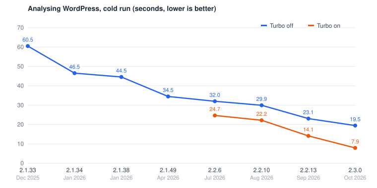

# PHPStan Turbo

A native PHP extension that makes PHPStan about 60% faster on a cold run. It
reimplements most of PHPStan's analysis engine in C++, and it also lets PHPStan
run faster in ways a plain PHP program can't.

The extension is optional. PHPStan runs fine without it, and the analysis
result is bit-for-bit identical with and without it. Only the speed changes.


## Installation

**Most users don't need to install anything.** The
[phpstan/phpstan](https://github.com/phpstan/phpstan) Composer package ships
prebuilt binaries for the most common platforms. These are Linux (glibc and
musl, x86_64 and arm64), macOS (arm64) and Windows (x86_64), for PHP 8.2 and
newer. PHPStan picks the binary matching the running PHP and restarts itself
with it loaded through `-d extension=`.

Install the extension with [PIE](https://github.com/php/pie) only when you run
a `phpstan.phar` you downloaded yourself, outside Composer. The binaries ship
next to the phar in the Composer package, not inside it:

```bash
pie install phpstan/turbo
```

- `vendor/bin/phpstan diagnose` reports the extension's status.
- There's no switch to turn it off. An installed, matching extension is always
  used.
- The extension only activates when its version matches the one the PHPStan
  release expects. On a mismatch PHPStan prints a note and runs without it, so
  an outdated extension can only cost speed, never change results.

## Where the speed comes from



Analysing WordPress on an M1 Pro, from the
[PHPStan 2.3 release article](https://phpstan.org/blog/phpstan-2-3-leap-in-performance).
The gap between the lines is Turbo. It grew from 23% in 2.2.6, the first release
with Turbo, to 59% in 2.3.0.

Here is how the time Turbo saves on PHPStan's analysis of its own `src/` splits
across its parts. Percentages are of the time without Turbo:

| Part | Time saved | Since |
|---|---|---|
| Native hot paths | 16% | 2.2.6 |
| Forked workers | 4% | 2.2.10 |
| Trusted types | 8% | 2.2.13 |
| Native analysis engine | 30% | 2.3.0 |
| **Total** | **58%** | |

To read these: a run that takes 20 seconds without Turbo takes 8 seconds with
it, which is 60% less time, or 2.5× faster.

Trusted types need OPcache, because they're an OPcache optimizer pass. PHPStan's
restart enables OPcache for every run that can fork, with or without Turbo, so
the baseline without Turbo has OPcache too.

## How it works

### Shadowing

Every native class replaces a PHP class of the same name. Nothing in PHPStan
asks whether Turbo is loaded. The PHP class is the reference implementation
and is what runs without the extension, and the C++ class is a twin of it.

A PHP class with a native twin carries the `#[ShadowedByTurboExtension]`
attribute. When the extension's version matches, PHPStan declares the native
classes under their real names before any of the PHP twins can load. From then
on, `PHPStan\TrinaryLogic` *is* the native class. Every `instanceof`, type hint
and DI lookup resolves to it, and reflection still reads the PHP declaration
with its PHPDocs. Native and PHP classes can extend each other, so PHPStan's
class hierarchy stays as it is.

### What makes a port pay off

A call across the boundary between PHP and C++ costs about as much as a
userland call. A native loop that calls back into PHP for every element is as
slow as the PHP loop it replaced. A port pays off when it absorbs a whole call
subtree, such as a loop, a recursive walk or a chain of handlers, and returns to
PHP once at the end. That's why the gain jumped in 2.3.0, when the analysis
engine was ported as one unit instead of class by class.

Every port is benchmarked, and ports that gain 0.5% or less get reverted:
unproven native code is maintenance debt. [CLAUDE.md](CLAUDE.md) has the rules
in full.

### Native hot paths

Turbo 2.2.x shadowed a handful of classes that each absorbed millions of tiny
calls:

- `TrinaryLogic`
- the scope's expression holders and merge logic
- the expression-result storage
- a memoizing `TypeCombinatorCache`
- php-parser's `NodeTraverser`
- the symbol scanners used for discovering classes and functions

### Native analysis engine

Turbo 2.3.x shadows most of the analysis engine, about 350 classes. That
covers `NodeScopeResolver`, `MutatingScope`, `TypeSpecifier`, every expression
and statement handler, the `Type` implementations, `TypeCombinator`, and the
reflection classes the engine uses most. What stays PHP: rules, third-party
extensions, BetterReflection and phpdoc-parser. The extension APIs work
unchanged.

### Native parser

The extension reimplements php-parser's parser engine, from the shift/reduce
loop to building the AST. Tokenization stays in PHP's own tokenizer. The
resulting ASTs are byte-identical to php-parser's, which is verified over
thousands of files and over php-parser's own test suite.

### Trusted types

PHPStan analyses its own source code on level 8, so the engine's run-time
checks of PHPStan's parameter and return types mostly re-check what analysis
already proved. Every class-typed parameter costs a class lookup and an
`instanceof` on each call. Turbo registers an OPcache optimizer pass that drops
these checks from code compiled out of the PHPStan phar.

Code outside the phar keeps its checks, including on values PHPStan passes to
it. The one thing lost is the TypeError at the boundary when an extension
passes a wrong value into PHPStan. `--debug` keeps all checks, so running with
it reproduces the original error.

### Forked workers

A spawned worker boots PHPStan from scratch: autoloader, DI container,
reflection caches. A forked worker inherits the booted process and OPcache's
warm opcode cache.

PHP running from a phar can't normally fork safely. All processes share one
file descriptor for the archive and race on its read position. Turbo gives
each forked worker its own. Forking isn't available on Windows.

### Shared memory between workers

Some read-mostly data is computed once per run and shared through shared
memory instead of every worker holding its own copy. This covers the function
signature map, the symbol indexes and PHPStan's file caches. It saves memory
more than time.

### One core per platform

Each platform ships one shared core with all the code, and each PHP version
gets a thin extension of about 70 KB that loads the core. This took the
Composer package from 268 MB unzipped to 87 MB.

## Why it stays correct

The PHP twin is the specification. Behaviour gets fixed there first and ported
second. These checks hold the two sides together:

- **Parity checks**: every public method of a twin has a native counterpart
  with the same parameter names, optionality and types, so named arguments and
  reflection behave the same.
- **Differential tests**: native and PHP implementations run on the same
  inputs and must return the same results. Every shadowed class must have
  coverage.
- **Walk traces**: a whole analysis walk is recorded with the PHP classes and
  with the native ones, including every node, both type flavours of every
  expression and the scope at every statement. The two traces must be
  identical.
- **Parser corpora**: byte-identical ASTs, errors and tokens over this
  repository and over php-parser's own test suite.
- **The full test suite** runs with the extension loaded, and the analysis
  output is compared with and without it.
- **UBSan and clang-tidy** run in CI.

A version gate covers releases. The extension's version is the short SHA of
the last commit that touched `turbo-ext/src/`, and each PHPStan release
expects exactly one. A stale or mismatched build stays inactive, and PHPStan
runs without it.

## Building

```bash
make build-turbo      # from the repository root
```

The build needs a C++17 compiler and `php-config` on PATH. To use the local
build, load it through an ini file, not with `-d extension=`. PHPStan's
restart re-executes the process and drops command-line `-d` flags:

```bash
mkdir -p /tmp/turbo-ini && echo "extension=$PWD/turbo-ext/phpstan_turbo.so" > /tmp/turbo-ini/turbo.ini
PHP_INI_SCAN_DIR=":/tmp/turbo-ini" php bin/phpstan analyse ...
```

[CLAUDE.md](CLAUDE.md) covers the rest of the developer side: porting a
class, testing, benchmarking, other build paths (PIE, Windows), updating
php-parser, and supporting a new PHP version.

## History

- The proof of concept used Zephir.
- The first full implementation was hand-written C, preserved on the
  `turbo-c-extension` branch. This C++ version is its port, first hosted in
  PHP-CPP and a plain Zend module since the Windows port.
- 2.2.6 (July 2026) shipped the hot-path ports, the native parser and the
  shared-memory arena.
- 2.2.10 forked workers from the phar.
- 2.2.13 added trusted types, with OPcache always on.
- 2.3.0 (October 2026) ported the analysis engine.
- 2.3.1 split the binaries into a shared core and thin extensions.
